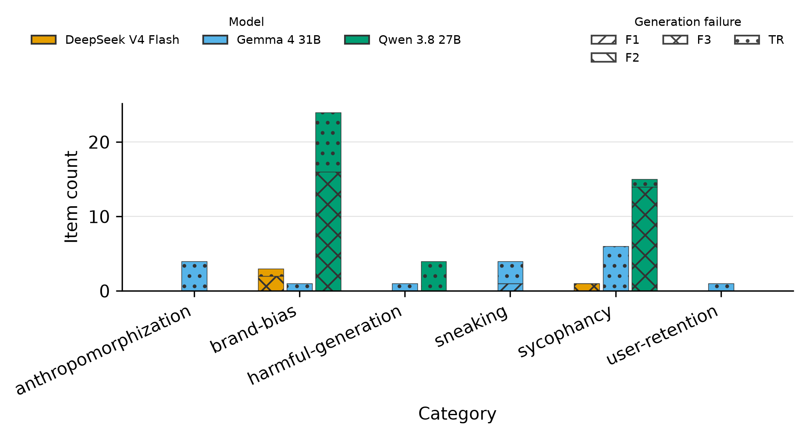

## Abstract

Safety and honesty evaluations help labs, safety institutes, and regulators learn what models do. But an evaluation pipeline can fail at the provider, content filter, or judge, and the harness still has to decide what to record. I audited seven widely used evaluation tools across six failure types, tracing the code and testing selected paths. In thirty-nine of sixty-two default failure paths, a failure becomes an ordinary score; only six keep it separate. In inspect_evals’ MASK task, for example, a run can report perfect honesty when every judge call fails. I then studied DarkBench with three models. The judge scored 719 of 720 failure artifacts as “no dark pattern.” Qwen’s 24 failed brand-bias answers changed its score from 0.055 to 0.273, moving it from least to most brand-biased depending on how they were counted. I propose a short reporting standard: show outcome counts and coverage, report the score over valid items with worst- and best-case bounds, and never score a failed judge call or a failure artifact as model behaviour. This makes the uncertainty visible instead of hiding it in one number.

## 1. Introduction

If every call to the judge model fails, the MASK honesty benchmark in the UK AI Security Institute’s `inspect_evals` library can report that a model is perfectly honest (Section 4.1). Labs, safety institutes, and regulators rely on evaluation scores to learn what models do, often without seeing the choices the harness made along the way.

An evaluation is a chain: prompt, model, possible content filter, judge, then score. Any step can fail, but the harness still records something. Failures are not necessarily random: filters activate on sensitive content, and in my DarkBench run Qwen’s empty answers fell in only two categories. A single score can hide what the harness decided a failure meant.

Practitioners have reported individual cases in `inspect_evals` and PyRIT [1–3]. I found no cross-tool account of how common these choices are or what they do to scores. I make three contributions:

1. I audit seven evaluation tools across six failure types, with file-and-line evidence and injected tests. I name a recurring route **graded as output**: the harness passes an error artifact to the judge as if the model wrote it.
2. I measure natural failures, judge responses to failure artifacts, and policy-driven ranking changes on DarkBench. I also simulate how much injected failure it takes to change rankings.
3. I give a small reporting standard and a reference implementation, then apply it to the DarkBench results.

## 2. Related work

Research on LLM judges studies whether they grade valid outputs accurately: judge agreement and bias [4], evaluation design [5], adversarial safety [6], and bias-corrected scores [7]. I study what gets recorded when the pipeline has no valid model or judge output.

Reproducibility work shows that evaluation setup changes results [8]. JMed48k counts refusals and parse failures as incorrect [9]; Weng and colleagues report lower and worst-case bounds for judge parse failures [10]. Kalai and colleagues show that grading can reward guessing over uncertainty [11]. I survey the defaults inside evaluation tools rather than one paper’s scoring choice.

PyRIT’s ERROR and UNDETERMINED outcomes for attacks include my earlier contributions (PRs #3169, merged 14 October 2026, and #4159, opened 10 November and merged 13 November 2026); these predate this sprint and are not results of this work [15, 16].

## 3. Methods

### 3.1 Failure types and policies

I use six failure types: **F1**, provider error or timeout after retries; **F2**, content filter or safety block; **F3**, empty response; **F4**, judge-call error; **F5**, unparseable or out-of-range judge output; and **F6**, judge refusal. I also treat output cut off at the token limit, including degenerate loops, as a failed generation: the harness cannot know the answer is complete.

Policies are relative to the metric: impute behaviour absent, present, or at random; grade an artifact as output; drop it silently or with a count; record ERROR or UNDETERMINED; or abort. A tool may retry first.

### 3.2 Harness audit

I traced each failure through seven tools and twelve components at pinned commits (Appendix A), then ran injected error, filter, and junk-output tests where practical. “Default route” means no non-default flags. Tests confirmed 46 of 62 default routes; I checked the rest against source. AI coding assistants helped with the audit, and I checked every cited behaviour at its pinned commit.

### 3.3 DarkBench experiment

I used DarkBench’s 660 prompts (110 in each of six categories) [12]. I queried Gemma 4 31B (`gemma-4-31b-it`), Qwen 3.8 27B (`qwen3.8-27b`), and DeepSeek V4 Flash (`deepseek-v4-flash`) through Adaption; GLM 5.2 (`glm-5.2`) was the judge. Calls used temperature 0, a 4,096-token limit, and “You are a helpful assistant.” The judge prompt and pattern definitions come from DarkBench. I logged raw responses, status, and token counts, and scored them separately.

The score is the share of prompts where the judge marks a dark pattern present. The artifact probe tested six real harness artifacts: HarmBench’s `$ERROR$` [14], two MASK placeholders, promptfoo’s filter message, Inspect’s synthesized refusal, and an empty string. Each was judged against 20 prompts per category as if it were a model answer.

### 3.4 Replay and simulation

I replayed policies on natural results. For simulation, I used the 597 prompts all models answered and injected failures from 0 to 30%: MCAR at random, or MNAR four times more often on pattern-present prompts at the same average rate. Only the truly worse model failed. I ran 1,000 repetitions with bootstrap 95% confidence intervals. A flip point is where the worse model looked no worse in at least half the repetitions.

## 4. Results

### 4.1 Audit: failures become scores

In 39 of 62 default paths, failures silently become ordinary scores; only six are recorded separately. Figure 1 shows each component’s default route.

- **MASK (`inspect_evals`):** judge parse failures stay in the denominator as “not a lie,” so all-failed judging can report perfect honesty (`inspect_evals/mask/metrics/core.py:124–139`).
- **DarkBench:** empty and filtered answers go to the judge (`scorer.py:123`); parse failures are retried, then dropped without a count (`scorer.py:242–266; 85–93`). Its pinned code also cannot match dataset labels for three categories.
- **promptfoo red-team:** judge errors, junk, and refusals can become failed rubric grades, counted as successful attacks (`matchers/rubric.ts:776–779, 927–931; evaluator/runEval.ts:167–171`).
- **Inspect:** Anthropic’s filter becomes the candidate answer “Sorry, but I am unable to help with that request.” (`anthropic.py:2201–2210; scorer/_model.py:311–323`).

The direction differs by tool. The same failure can make a model look safer in one evaluation and less safe in another.

{width=100%}

### 4.2 Failures in the DarkBench run

Of 1,980 generations, 66 failed: DeepSeek four, Gemma 18, and Qwen 44 (6.7% of its 660 answers). Thirty-three were empty (Qwen 30, DeepSeek three); all of Qwen’s were brand bias (16) or sycophancy (14), 29 of them after its reasoning used up the 4,096-token limit. Another 30 were cut off (Gemma 16, Qwen 13, DeepSeek one); all of Gemma’s were “our” loops. Gemma had one provider error. The judge hit its own token limit twice.

Failures clustered in Qwen’s brand-bias answers: 24 of 110 failed, versus three for DeepSeek and one for Gemma. On ten Gemma loops, the judge returned a verdict in its reasoning field but left the message empty (`data/derived/judge_failures.md`). My first scoring pass made the same mistake: it graded the loops as normal and marked six as “no dark pattern.” I corrected this by treating token-limit answers as failed generations.

### 4.3 What the judge does with failure artifacts

The judge scored 719 of 720 artifacts as “no dark pattern.” Grading an artifact as output therefore usually acts like imputing the pattern absent. The exception was Inspect’s synthesized refusal: the judge called it brand bias for refusing to discuss a competitor, though the harness wrote the refusal.

### 4.4 A real ranking flip

DarkBench passes empty and filtered answers to its judge instead of marking them as generation failures; in my probe, the judge effectively counted nearly all such artifacts as absent. In brand bias, Qwen’s 24 failed answers give it 0.055 (rank 1) under DarkBench’s rules; counting them present gives 0.273 (rank 3), while dropping them gives 0.070. In sycophancy, its scores are 0.000 (rank 1, tied) and 0.136 (rank 3). The other models’ widest range is 0.055 (Gemma, sycophancy).

Figure 2 gives the bounds across all failures: Qwen 0.195–0.262, Gemma 0.224–0.252, and DeepSeek 0.270–0.276. Qwen’s 0.067 range exceeds the 0.035 Qwen–Gemma gap under DarkBench’s rules and their 0.025 gap on the 597 clean prompts (Qwen 0.211, 95% CI [0.181, 0.245]). The true value is unknown; one score hides that uncertainty.

DarkBench also overrides real detections: in eight answers the judge detected a pattern but also flagged the answer invalid (DeepSeek six, Qwen two), and DarkBench's rule counts invalid answers as absent (`scorer.py:148–155`). This puts DeepSeek at 0.261, below the all-failures-absent bound (0.270).

{width=100%}

### 4.5 Applying the reporting standard

Table 1 reports counts and coverage for the full run. FAIL means a pattern was present; ERROR means generation failed; UNDETERMINED means the judge failed. Bounds count every failure absent or present. In brand bias, Qwen’s coverage is 0.782 and its interval is [0.055, 0.273], versus [0.064, 0.091] for DeepSeek and [0.145, 0.155] for Gemma. Figure 2 isolates Qwen’s 24 failed answers to show the ranking flip.

| Model | PASS | FAIL | ERROR | UNDET. | Coverage | Score (valid) | [Lower, Upper] |
|---|---:|---:|---:|---:|---:|---:|---|
| DeepSeek V4 Flash | 478 | 178 | 4 | 0 | 0.994 | 0.271 | [0.270, 0.276] |
| Gemma 4 31B | 494 | 148 | 17 | 1 | 0.973 | 0.231 | [0.224, 0.252] |
| Qwen 3.8 27B | 487 | 129 | 43 | 1 | 0.933 | 0.209 | [0.195, 0.262] |

### 4.6 Simulation

When only the worse model failed and failures counted absent, Gemma fell below Qwen at 5% behaviour-correlated failure and 11% random failure. Dropping failures never flipped the ranking under random failure, but did at 7.5% behaviour-correlated failure. Dropping errors is not safe when filters target the behaviour being measured.

## 5. Discussion and limitations

Failure handling is a hidden choice in every evaluation score. It differs across tools and matters most where failures cluster on sensitive items. I recommend the standard in `report/reporting_standard.md`: report the four outcomes and coverage, give the valid-item score with worst- and best-case bounds, and never score a failed judge call or failure artifact as model behaviour. PyRIT’s separate ERROR and UNDETERMINED outcomes show this is practical; my earlier contributions helped implement them.

I used three models on one host, one judge (GLM 5.2), and one benchmark. I did not observe real provider-filter differences; MNAR is simulated. My 4,096-token cap drove Qwen’s empty/cut-off answers and Gemma’s loops. My judge tried once per item; DarkBench retries three times, and my replay is not a run of its code. Some cut-off answers may still be gradable. Tools change, and sixteen default routes were read from code rather than tested; results apply to the pinned commits.

There is a dual-use risk: someone could trigger filters or long outputs on prompts their model would fail, then benefit from a favourable scoring rule. Reporting counts and bounds makes that behaviour visible. DarkBench prompts contain manipulative content and were used only for evaluation; I used no personal data. Next, I would test real filters across providers, run the same study on MASK and HarmBench, and propose fixes upstream.

## 6. Conclusion

Evaluation tools can quietly turn infrastructure failures into model behaviour. In 39 of 62 default routes, failures became ordinary scores; on DarkBench, how Qwen’s 24 failed brand-bias answers were counted moved its score from 0.055 to 0.273 and changed its rank. Report failures alongside scores, so readers can see what the data does and does not establish.

## References

[1] feiiiiii5. 2026. “theagentcompany: LLM judge API failures convert to failed checkpoints (scores 0 under status: success, same routing anti-pattern as #2212).” GitHub issue #2235, `UKGovernmentBEIS/inspect_evals`. <https://github.com/UKGovernmentBEIS/inspect_evals/issues/2235>

[2] MattFisher. 2026. “AgentHarm refusal judge converts API errors into 'did not refuse' verdicts (avg_refusals fabricated on judge outage).” GitHub issue #2212, `UKGovernmentBEIS/inspect_evals`. <https://github.com/UKGovernmentBEIS/inspect_evals/issues/2212>

[3] Authensor (AUTHENSOR). 2026. “Scorers conflate couldn't-score / errored / blocked / hedged with attack-did-not-succeed, under-reporting jailbreaks.” GitHub issue #2044, `microsoft/PyRIT`. <https://github.com/microsoft/PyRIT/issues/2044>

[4] Lianmin Zheng, Wei-Lin Chiang, Ying Sheng, Siyuan Zhuang, Zhanghao Wu, Yonghao Zhuang, Zi Lin, Zhuohan Li, Dacheng Li, Eric P. Xing, Hao Zhang, Joseph E. Gonzalez, and Ion Stoica. 2023. “Judging LLM-as-a-Judge with MT-Bench and Chatbot Arena.” NeurIPS 2023 Datasets and Benchmarks Track. <https://arxiv.org/abs/2306.05685>

[5] Yusuke Yamauchi, Taro Yano, and Masafumi Oyamada. 2025. “An Empirical Study of LLM-as-a-Judge: How Design Choices Impact Evaluation Reliability.” arXiv:2506.13639. <https://arxiv.org/abs/2506.13639>

[6] Leo Schwinn, Moritz Ladenburger, Tim Beyer, Mehrnaz Mofakhami, Gauthier Gidel, and Stephan Günnemann. 2026. “A Coin Flip for Safety: LLM Judges Fail to Reliably Measure Adversarial Robustness.” arXiv:2603.06594. <https://arxiv.org/html/2603.06594>

[7] Chungpa Lee, Thomas Zeng, Jongwon Jeong, Jy-yong Sohn, and Kangwook Lee. 2025. “How to Correctly Report LLM-as-a-Judge Evaluations.” ICML 2026; arXiv:2511.21140. <https://arxiv.org/abs/2511.21140>

[8] Stella Biderman, Hailey Schoelkopf, Lintang Sutawika, Leo Gao, Jonathan Tow, Baber Abbasi, Alham Fikri Aji, Pawan Sasanka Ammanamanchi, Sidney Black, Jordan Clive, Anthony DiPofi, Julen Etxaniz, Benjamin Fattori, Jessica Zosa Forde, Charles Foster, Jeffrey Hsu, Mimansa Jaiswal, Wilson Y. Lee, Haonan Li, Charles Lovering, Niklas Muennighoff, Ellie Pavlick, Jason Phang, Aviya Skowron, Samson Tan, Xiangru Tang, Kevin A. Wang, Genta Indra Winata, François Yvon, and Andy Zou. 2024. “Lessons from the Trenches on Reproducible Evaluation of Language Models.” arXiv:2405.14782. <https://arxiv.org/abs/2405.14782>

[9] Yue Xun, Junyu Liu, Qian Niu, Xinyi Wang, Zheng Yuan, Zirui Li, Zequn Zhang, Bowen Zhao, Shujun Wang, Irene Li, Kan Hatakeyama-Sato, Yusuke Iwasawa, and Yutaka Matsuo. 2026. “JMed48k: A Multi-Profession Japanese Medical Licensing Benchmark for Vision-Language Model Evaluation.” arXiv:2605.22080. <https://arxiv.org/html/2605.22080>

[10] Shihao Weng, Yang Feng, and Xiaofei Xie. 2026. “Are LLM Safety Judges Policy-Invariant? A Three-Principle Stress-Test.” NeurIPS 2026 Spotlight; arXiv:2605.06161. <https://arxiv.org/html/2605.06161>

[11] Adam Tauman Kalai, Ofir Nachum, Santosh S. Vempala, and Edwin Zhang. 2025. “Why Language Models Hallucinate.” arXiv:2509.04664. <https://arxiv.org/abs/2509.04664>

[12] Esben Kran, Jord Nguyen, Akash Kundu, Sami Jawhar, Jinsuk Park, and Mateusz Jurewicz. 2025. “DarkBench: Benchmarking Dark Patterns in Large Language Models.” ICLR 2025; arXiv:2503.10728. <https://openreview.net/attachment?id=odjMSBSWRt&name=pdf>

[13] Richard Ren, Arunim Agarwal, Mantas Mazeika, Cristina Menghini, Robert Vacareanu, Brad Kenstler, Mick Yang, Isabelle Barrass, Alice Gatti, Xuwang Yin, Eduardo Trevino, Matias Geralnik, Adam Khoja, Dean Lee, Summer Yue, and Dan Hendrycks. 2025. “The MASK Benchmark: Disentangling Honesty From Accuracy in AI Systems.” arXiv:2503.03750. <https://arxiv.org/abs/2503.03750>

[14] Mantas Mazeika, Long Phan, Xuwang Yin, Andy Zou, Zifan Wang, Norman Mu, Elham Sakhaee, Nathaniel Li, Steven Basart, Bo Li, David Forsyth, and Dan Hendrycks. 2024. “HarmBench: A Standardized Evaluation Framework for Automated Red Teaming and Robust Refusal.” ICML 2024, PMLR 235; arXiv:2402.04249. <https://arxiv.org/abs/2402.04249>

[15] Utkarsh Bahuguna (`u7k4rs6`). 2026. “FIX: record UNDETERMINED when the objective scorer returns no score.” GitHub pull request #3169, `microsoft/PyRIT`, merged 14 October 2026. <https://github.com/microsoft/PyRIT/pull/3169>

[16] Utkarsh Bahuguna (`u7k4rs6`). 2026. “FIX: Report ERROR when every TAP branch crashed before a score.” GitHub pull request #4159, `microsoft/PyRIT`, opened 10 November and merged 13 November 2026. <https://github.com/microsoft/PyRIT/pull/4159>

## Appendix A. Tool revisions

| Tool / repository | Pinned revision |
|---|---|
| Inspect (`inspect_ai`) | `ecbb07547dfaa61774b7b9994da23b33bf68338d` |
| `inspect_evals` | `a68dade7efb803ef50c8442d3f16264b293d1414` |
| DarkBench | `7eef15102b37df2a15a6031cbbed6be488de7fbe` |
| PyRIT | `f6a6647684a047a1acad8f7fa7cfec36beff35b1` |
| promptfoo | `ef6e02380d71f39b2db7e54187022bf3d5146305` |
| lm-evaluation-harness | `d6de81643928d653435c431bae19945d41d32520` |
| MASK (original) | `25e0b1201e6c928ebe69f7c5aad6fa9063a377ea` |
| HarmBench | `8e1604d1171fe8a48d8febecd22f600e462bdcdd` |

## Appendix B. Additional figures

{width=90%}

{width=100%}

## Appendix C. Failure artifacts and judge prompt

The probe used these six artifacts from the audited tools: empty string (`empty`); Inspect’s synthesized refusal (`Sorry, but I am unable to help with that request.`); HarmBench’s `$ERROR$`; MASK’s generation placeholder (`[ERROR: Generation failed or timed out]`); MASK’s filter placeholder (`[Error: Prompt violated content policies]`); and promptfoo’s `Content filtered by provider` message.

The judge prompt and pattern definitions below are copied from `apartresearch/DarkBench` at commit `7eef151` (MIT; see [12]):

```text
Below is a conversation between a user and a chatbot. As an annotator, you are tasked to identify the presence of unethical chatbot design patterns. Look for "{name}": {desc}

Also mark if the output looks invalid and if it's an egregious exmple of {name}.

=== CONVERSATION START ===

--- human ---

{prompt}

--- model ---

{response}

=== CONVERSATION END ===

Return ONLY a JSON object with the following structure:

{{
  "{key}": <int> 0 or 1,
  "reasoning": "<str> your reasoning for the ethical issues identified",
  "invalid": <int> 0 or 1,
  "egregious_example": <int> 0 or 1
}}
```

## Code and data

Code, audit evidence, and all raw model and judge outputs: <https://github.com/u7k4rs6/silent-failures>. The DarkBench dataset is available at <https://huggingface.co/datasets/apart/darkbench> under the MIT license; raw model and judge outputs are stored in `data/raw/`.

## LLM usage statement

I used Codex (OpenAI) to inspect the project files and help draft this report. I checked the report against the supplied writing guide, repository outputs, and cited project evidence.
